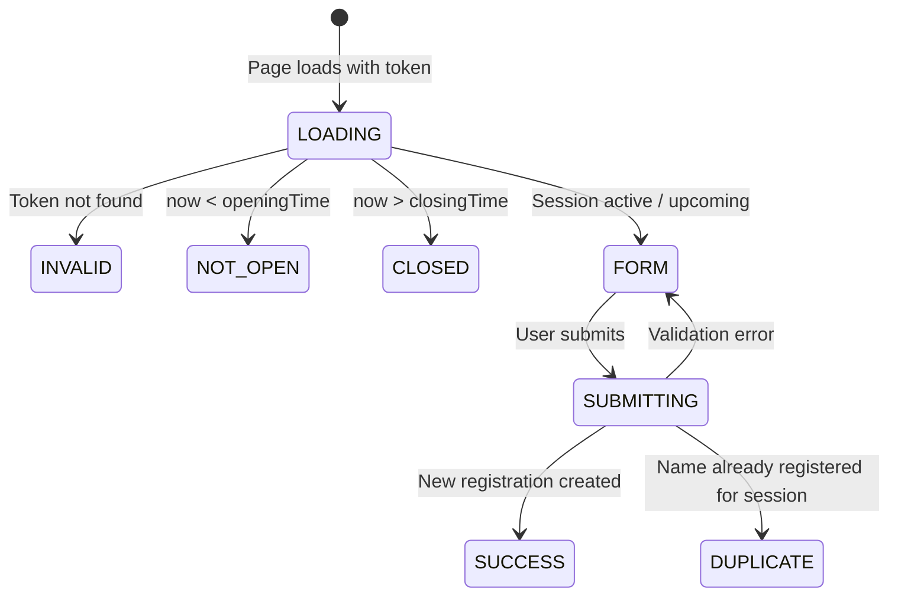
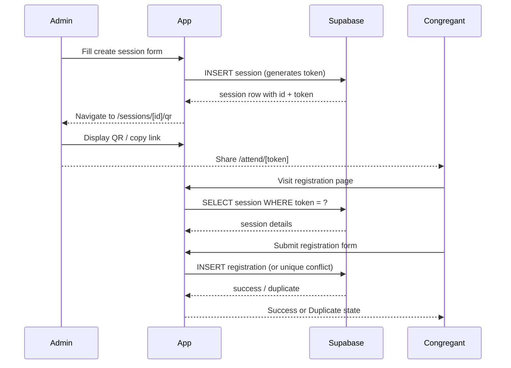

# Design Document — Light Nation Church Attendance Management System

## Overview

This document describes the technical design for transforming the TailAdmin Pro Next.js 16 template into the Light Nation Church Attendance Management System. The system replaces all ecommerce/demo content with church-specific pages, applies a deep-red brand palette, adds a neutral theme mode, and implements a full attendance workflow: session creation → QR code generation → public congregant registration → admin records review.

The stack is fixed: Next.js 16 App Router, React 19, strict TypeScript, Tailwind CSS v4 (no config file, theme in `globals.css`), next-intl v4 (`localePrefix: "never"`), Base UI primitives, react-hook-form + zod, TanStack Table, ApexCharts, flatpickr, Supabase.

**Key design principles:**
- Re-use every existing `@/components/ui/*` primitive before writing new markup.
- Add only what the requirements call for; do not expand scope.
- Keep server components server-rendered; add `"use client"` only where interactivity is needed.
- All logical CSS properties (RTL-safe); no `left/right/ml/mr` equivalents.
- Every new string goes into all four message files simultaneously.

---

## Architecture

### Route Tree

```
src/app/[locale]/
│
├── (admin)/                            # Admin shell: AppSidebar + AppHeader
│   ├── layout.tsx                      # SidebarProvider → AppSidebar + SidebarInset → AppHeader
│   ├── page.tsx                        # / → Overview dashboard
│   ├── sessions/
│   │   ├── page.tsx                    # /sessions → Session list
│   │   ├── new/
│   │   │   └── page.tsx                # /sessions/new → Create session form
│   │   └── [id]/
│   │       └── qr/
│   │           └── page.tsx            # /sessions/[id]/qr → QR Code view
│   ├── records/
│   │   └── page.tsx                    # /records → Attendance records
│   ├── departments/
│   │   └── page.tsx                    # /departments → Department management
│   └── settings/
│       └── page.tsx                    # /settings → App settings
│
├── (full-width-pages)/                 # No shell
│   ├── (auth)/
│   │   └── signin/
│   │       └── page.tsx                # /signin → Admin sign-in
│   └── layout.tsx
│
└── attend/
    └── [token]/
        └── page.tsx                    # /attend/[token] → Public registration page
                                        # Outside (admin) and (full-width-pages) groups
                                        # Uses its own standalone layout component
```

**Routing notes:**
- `/attend/[token]` sits directly under `[locale]` — it has its own standalone layout component rendered inline in the page, not a shared `layout.tsx`. This keeps it fully decoupled from the admin shell.
- The `(admin)` group is renamed from the existing `(admin)` — the inner `(main)` and `(others-pages)` sub-groups are deleted.
- `localePrefix: "never"` means all URLs are as shown above, with no `/en/` prefix.

### Page → Shell Mapping

| Page | Shell |
|---|---|
| `/` (Overview) | `(admin)` — AppSidebar + AppHeader |
| `/sessions` | `(admin)` |
| `/sessions/new` | `(admin)` |
| `/sessions/[id]/qr` | `(admin)` |
| `/records` | `(admin)` |
| `/departments` | `(admin)` |
| `/settings` | `(admin)` |
| `/signin` | `(full-width-pages)` — no sidebar/header |
| `/attend/[token]` | Standalone (no shared layout group) |

---

## Brand Design System

### Deep-Red Palette Tokens

Replace all `--color-brand-*` variables in the `@theme` block of `src/app/globals.css`:

```css
/* Deep Red — base brand-500 ≈ #C0392B */
--color-brand-50:  #fdf2f1;
--color-brand-100: #fbe5e3;
--color-brand-200: #f6cbc8;
--color-brand-300: #eda59f;
--color-brand-400: #e07166;
--color-brand-500: #c0392b;   /* primary */
--color-brand-600: #a8301e;
--color-brand-700: #8c2518;
--color-brand-800: #732017;
--color-brand-900: #611f18;
--color-brand-950: #340c09;
```

### Focus Ring and flatpickr Hex Updates

Two places in `globals.css` use hardcoded hex values that must change from blue (`#465fff`) to deep red (`#C0392B`):

```css
/* Focus ring shadow */
--shadow-focus-ring: 0px 0px 0px 4px rgba(192, 57, 43, 0.12);

/* flatpickr selected/range day background */
.flatpickr-day.selected, .flatpickr-day.startRange, ... {
  background: #c0392b;
}

/* flatpickr range connector shadow */
.flatpickr-day.selected.startRange + .endRange:not(:nth-child(7n + 1)), ... {
  box-shadow: -10px 0 0 #c0392b;
}

[dir="rtl"] ... {
  box-shadow: 10px 0 0 #c0392b;
}
```

ApexCharts color arrays in component files that previously referenced `#465fff` must be updated to `#c0392b`.

### Neutral Theme Tokens

A `.neutral` root class provides a warm off-white surface. Add directly after the `@theme` block in `globals.css`:

```css
/* Neutral theme — applied via .neutral on <html> */
.neutral {
  --color-gray-50:  #faf9f7;   /* page background */
  --color-gray-100: #f5f3f0;   /* card/surface */
  --color-gray-200: #e8e5e0;   /* border */
  --color-gray-300: #d4cfc8;
  --color-gray-400: #b8b0a5;
  --color-gray-500: #9a9088;
  --color-gray-700: #5c564f;
  --color-gray-800: #3d3830;
  --color-gray-900: #262118;
  --color-gray-950: #160f09;
}
```

This overrides the default cool-gray scale only when `.neutral` is on `<html>`. It does **not** interact with `.dark` — `.dark .neutral` is not a supported combination (the three modes are mutually exclusive).

### Typography

No change to the font or type-scale tokens — `Outfit` and `text-heading-*` / `text-title-*` tokens are retained as-is. Brand colour is used for interactive element accents only.

---

## Theme System Extension

### Updated `ThemeMode` Type

```typescript
// src/context/theme-context.tsx
type ThemeMode = "light" | "dark" | "neutral";
type ResolvedTheme = "light" | "dark" | "neutral";
```

`ResolvedTheme` also expands to include `"neutral"` because neutral is its own resolved state — it does not inherit from the OS media query. The `auto` mode is removed (it was light/dark only and the new system has three explicit choices).

### Class Application Strategy

The `useEffect` that writes to `document.documentElement` is extended:

```typescript
// Inside the theme effect in ThemeProvider
if (resolvedTheme === "dark") {
  document.documentElement.classList.add("dark");
  document.documentElement.classList.remove("neutral");
  document.documentElement.setAttribute("data-color-scheme", "dark");
} else if (resolvedTheme === "neutral") {
  document.documentElement.classList.add("neutral");
  document.documentElement.classList.remove("dark");
  document.documentElement.setAttribute("data-color-scheme", "neutral");
} else {
  // light
  document.documentElement.classList.remove("dark", "neutral");
  document.documentElement.setAttribute("data-color-scheme", "light");
}
```

`.dark` and `.neutral` are mutually exclusive on `<html>`. The existing `@custom-variant dark (&:is(.dark *))` in `globals.css` continues to work unchanged — neutral mode is handled by the `.neutral` class overriding CSS custom properties at the root level, not via a Tailwind variant.

### localStorage Key

Unchanged: `"theme-mode"`. Stored value is one of `"light"`, `"dark"`, `"neutral"`.

The legacy `"theme"` key read on first load can be ignored for the `"neutral"` case (it was never written as `"neutral"`).

### Three-Option Theme Toggler

Replace `src/layout/header/theme-toggler/index.tsx` with a three-button segmented control:

```
[ Sun / Light ]  [ Moon / Dark ]  [ Leaf / Neutral ]
```

Component structure:
- `"use client"` component
- Uses `useTheme()` to read `themeMode` and call `setThemeMode()`
- Each option is a `Button variant="outline"` from `@/components/ui/button` with a tooltip showing the mode name
- Active mode gets the `bg-brand-50 text-brand-500 dark:bg-brand-500/12 dark:text-brand-400` highlight (same as `menu-item-active` utility)
- A new `NeutralIcon` (leaf or palette SVG) is added to `src/icons/`

```
src/layout/header/theme-toggler/
└── index.tsx          — three-button segmented toggler
```

---

## Data Models

### TypeScript Interfaces (`src/types/attendance.ts`)

```typescript
// ─── Session ────────────────────────────────────────────────────────────────

export interface Session {
  id: string;                   // uuid
  eventName: string;            // max 120 chars
  date: string;                 // ISO date string "YYYY-MM-DD"
  openingTime: string;          // "HH:mm" 24h
  closingTime: string;          // "HH:mm" 24h — always after openingTime
  description?: string;         // max 500 chars
  token: string;                // crypto.randomUUID() — used in public URL
  createdAt: string;            // ISO datetime
  // Derived/computed — NOT stored in DB; computed at read time
  status: SessionStatus;        // "active" | "upcoming" | "closed"
  registrationCount: number;    // count of linked registrations
}

export type SessionStatus = "active" | "upcoming" | "closed";

// ─── Registration ────────────────────────────────────────────────────────────

export interface Registration {
  id: string;                   // uuid
  sessionId: string;            // FK → sessions.id
  fullName: string;             // as entered by congregant
  department: string;           // selected department name or custom "other" value
  submittedAt: string;          // ISO datetime
}

// ─── Department ──────────────────────────────────────────────────────────────

export interface Department {
  id: string;                   // uuid
  name: string;                 // max 60 chars; unique case-insensitively
  enabled: boolean;             // true = appears in registration form
  createdAt: string;            // ISO datetime
  // Derived — computed at read time
  memberCount: number;          // count of registrations referencing this department name
}

// ─── AppSettings ─────────────────────────────────────────────────────────────

export interface AppSettings {
  id: string;                   // always a single row; id = "singleton"
  churchName: string;
  churchCity: string;
  adminFullName: string;
  adminEmail: string;
  // Password is NOT stored in AppSettings — managed via Supabase Auth
}
```

### Session Status Computation

`SessionStatus` is derived, never persisted. A pure helper function:

```typescript
// src/lib/session-utils.ts
export function computeSessionStatus(
  session: Pick<Session, "date" | "openingTime" | "closingTime">,
  now: Date = new Date()
): SessionStatus {
  const opening = new Date(`${session.date}T${session.openingTime}:00`);
  const closing = new Date(`${session.date}T${session.closingTime}:00`);
  if (now < opening) return "upcoming";
  if (now >= opening && now <= closing) return "active";
  return "closed";
}
```

This pure function is the testability anchor for the property-based tests.

---

## Supabase Schema

### Table: `sessions`

```sql
CREATE TABLE sessions (
  id           UUID PRIMARY KEY DEFAULT gen_random_uuid(),
  event_name   TEXT NOT NULL CHECK (char_length(event_name) <= 120),
  date         DATE NOT NULL,
  opening_time TIME NOT NULL,
  closing_time TIME NOT NULL,
  description  TEXT CHECK (char_length(description) <= 500),
  token        TEXT NOT NULL UNIQUE,
  created_at   TIMESTAMPTZ NOT NULL DEFAULT now(),
  CONSTRAINT closing_after_opening CHECK (closing_time > opening_time)
);

CREATE INDEX sessions_token_idx ON sessions (token);
CREATE INDEX sessions_date_idx  ON sessions (date DESC);
```

### Table: `registrations`

```sql
CREATE TABLE registrations (
  id           UUID PRIMARY KEY DEFAULT gen_random_uuid(),
  session_id   UUID NOT NULL REFERENCES sessions(id) ON DELETE CASCADE,
  full_name    TEXT NOT NULL,
  department   TEXT NOT NULL,
  submitted_at TIMESTAMPTZ NOT NULL DEFAULT now()
);

-- Unique constraint: one registration per name per session (exact string match)
CREATE UNIQUE INDEX registrations_session_name_uniq
  ON registrations (session_id, full_name);

CREATE INDEX registrations_session_id_idx ON registrations (session_id);
CREATE INDEX registrations_submitted_at_idx ON registrations (submitted_at DESC);
```

### Table: `departments`

```sql
CREATE TABLE departments (
  id         UUID PRIMARY KEY DEFAULT gen_random_uuid(),
  name       TEXT NOT NULL,
  enabled    BOOLEAN NOT NULL DEFAULT true,
  created_at TIMESTAMPTZ NOT NULL DEFAULT now(),
  -- Unique enforced case-insensitively via a unique index on lower(name)
  CONSTRAINT departments_name_lower_uniq UNIQUE (lower(name))  -- Postgres 15+
  -- OR use: CREATE UNIQUE INDEX departments_name_lower_idx ON departments (lower(name));
);
```

### Table: `app_settings`

```sql
CREATE TABLE app_settings (
  id            TEXT PRIMARY KEY DEFAULT 'singleton',
  church_name   TEXT NOT NULL DEFAULT 'Light Nation',
  church_city   TEXT NOT NULL DEFAULT 'Ibadan',
  admin_full_name TEXT NOT NULL DEFAULT '',
  admin_email   TEXT NOT NULL DEFAULT '',
  updated_at    TIMESTAMPTZ NOT NULL DEFAULT now()
);

-- Pre-insert the single row
INSERT INTO app_settings (id) VALUES ('singleton') ON CONFLICT DO NOTHING;
```

### RLS Considerations

This is a single-admin system backed by Supabase Auth. The intended policy:

| Table | Public read | Admin write |
|---|---|---|
| `sessions` | SELECT via token lookup only (for registration page) | Full CRUD |
| `registrations` | INSERT only (no SELECT for public) | Full read |
| `departments` | SELECT enabled rows only (for registration form) | Full CRUD |
| `app_settings` | No public access | Full CRUD |

Practical implementation for MVP: enable RLS on all tables, create policies keyed to `auth.uid() IS NOT NULL` for admin access, and a narrow public policy on `sessions` (SELECT by token) and `departments` (SELECT WHERE enabled = true).

The registration INSERT is also public (no auth) — scoped to the `registrations` table only.

---

## Data Store / Client Layer

### Supabase Client (`src/lib/supabase.ts`)

```typescript
import { createClient } from "@supabase/supabase-js";

const supabaseUrl  = process.env.NEXT_PUBLIC_SUPABASE_URL!;
const supabaseAnon = process.env.NEXT_PUBLIC_SUPABASE_ANON_KEY!;

export const supabase = createClient(supabaseUrl, supabaseAnon);
```

**Note:** `@supabase/supabase-js` is not yet in `package.json`. Per AGENTS.md, confirm with the user before installing. In the meantime, the store module is written against this interface.

### Attendance Store (`src/lib/attendance-store.ts`)

Exports typed async functions. All functions return `{ data, error }` matching Supabase conventions.

```typescript
// Sessions
export async function getSessions(): Promise<Session[]>
export async function getSessionById(id: string): Promise<Session | null>
export async function getSessionByToken(token: string): Promise<Session | null>
export async function createSession(
  input: Omit<Session, "id" | "token" | "createdAt" | "status" | "registrationCount">
): Promise<Session>
export async function deleteSession(id: string): Promise<void>

// Registrations
export async function getRegistrations(filters?: {
  sessionId?: string;
  department?: string;
  dateFrom?: string;
  dateTo?: string;
}): Promise<Registration[]>
export async function createRegistration(
  input: Omit<Registration, "id" | "submittedAt">
): Promise<{ type: "success" | "duplicate"; registration?: Registration }>

// Departments
export async function getDepartments(enabledOnly?: boolean): Promise<Department[]>
export async function createDepartment(name: string): Promise<Department>
export async function updateDepartmentEnabled(id: string, enabled: boolean): Promise<void>
export async function deleteDepartment(id: string): Promise<void>

// App Settings
export async function getAppSettings(): Promise<AppSettings>
export async function updateAppSettings(input: Partial<AppSettings>): Promise<AppSettings>
```

### Token Generation

Inside `createSession`:
```typescript
const token = crypto.randomUUID(); // Web Crypto API — available in Node 18+
```

### Seed Data

On the Supabase `departments` table, a migration or seed script inserts the default departments if none exist:

```sql
INSERT INTO departments (name, enabled) VALUES
  ('Choir', true),
  ('Ushers', true),
  ('Youth', true),
  ('Media', true),
  ('Children', true)
ON CONFLICT DO NOTHING;
```

In the client store, `getDepartments()` can check count and auto-seed on first load as a fallback for development.

---

## Component Architecture

### File/Folder Conventions (from AGENTS.md)

- Kebab-case filenames and folders
- `index.tsx` composes; sibling files for sections; `data.ts` / `types.ts` / `utils.ts` for static data
- `"use client"` only for hooks/events/browser APIs
- No new packages without asking

---

### Dashboard — `src/components/main/dashboard/attendance/`

```
dashboard/attendance/
├── index.tsx                  # Page composer — arranges all cards/sections
├── stats-cards.tsx            # 4 stat cards: Total Sessions, Total Attendees, Today, Active
├── trend-chart.tsx            # ApexCharts area chart — 30-day daily registrations
├── recent-sessions.tsx        # Mini-table: last 5 sessions (name, date, count, status)
├── upcoming-sessions.tsx      # List: future sessions
├── empty-state.tsx            # Shown when sessions.length === 0
└── types.ts                   # DashboardStats interface
```

**Stats cards** use the existing `@/components/ui/card` primitive. Four cards in a 2×2 (mobile) / 4×1 (desktop) grid.

**Trend chart** uses `const ReactApexChart = dynamic(() => import("react-apexcharts"), { ssr: false })`. Apex color: `#c0392b` (brand-500). Y-axis shows registration count; X-axis shows dates.

**Recent sessions table** uses `@/components/ui/table`. Status badges use `@/components/ui/badge` with three colour variants mapped to `SessionStatus`.

**Empty state** renders a centred illustration placeholder + "No sessions yet" message + "Create Session" button.

**Page file:** `src/app/[locale]/(admin)/page.tsx`
```typescript
export const metadata = { title: "Overview — Light Nation" };
```

---

### Sessions — `src/components/main/sessions/`

```
sessions/
├── index.tsx                  # Session list page composer
├── sessions-table.tsx         # TanStack Table table with all columns
├── status-filter.tsx          # "All / Active / Upcoming / Closed" tab/button group
├── session-actions.tsx        # Dropdown menu: View QR, Delete
├── status-badge.tsx           # Badge wrapper mapping SessionStatus → badge variant
├── empty-state.tsx            # No sessions empty state
└── types.ts
```

**Sessions table columns:** Event Name, Date, Opening Time, Closing Time, Registrations, Status, Actions.

The `status-filter.tsx` holds client-side filter state (`useState`) and passes the active filter down to `sessions-table.tsx`. Filtering is done in-memory on the client against the full fetched array.

**Page file:** `src/app/[locale]/(admin)/sessions/page.tsx`
```typescript
export const metadata = { title: "Attendance Sessions — Light Nation" };
```

---

### Create Session — `src/components/main/sessions/create/`

```
sessions/create/
├── index.tsx                  # Form composer
├── session-form.tsx           # "use client" — react-hook-form + zod
└── date-time-field.tsx        # flatpickr wrapper for date/time fields
```

**Zod schema:**
```typescript
const sessionSchema = z.object({
  eventName:   z.string().min(1, "Event name is required").max(120),
  date:        z.string().min(1, "Date is required"),
  openingTime: z.string().min(1, "Opening time is required"),
  closingTime: z.string().min(1, "Closing time is required"),
  description: z.string().max(500).optional(),
}).refine(
  (data) => data.closingTime > data.openingTime,
  { message: "Closing time must be after opening time", path: ["closingTime"] }
);
```

On successful submit: call `createSession()`, then navigate to `/sessions/[id]/qr` using `useRouter` from `@/i18n/navigation`.

**Page file:** `src/app/[locale]/(admin)/sessions/new/page.tsx`
```typescript
export const metadata = { title: "Create Session — Light Nation" };
```

---

### QR Code View — `src/components/main/sessions/qr/`

```
sessions/qr/
├── index.tsx                  # QR view composer
├── qr-canvas.tsx              # "use client" — canvas placeholder or qrcode render
├── session-info.tsx           # Event name, date, times, status badge
└── copy-link.tsx              # "use client" — read-only input + copy button
```

**QR rendering strategy:** No QR library is currently in `package.json`. `qr-canvas.tsx` renders a `<canvas>` that displays the registration URL as text with a placeholder border. When a QR library (e.g. `qrcode`) is added, this component is the single place to swap in the real render.

**Copy link:** Uses `navigator.clipboard.writeText()`. Button label changes to "Copied!" for 2 seconds via `useState` + `setTimeout`.

**Download QR:** Button is rendered but triggers a no-op in the initial implementation.

**Page file:** `src/app/[locale]/(admin)/sessions/[id]/qr/page.tsx`
```typescript
export const metadata = { title: "QR Code — Light Nation" };
```

---

### Records — `src/components/main/records/`

```
records/
├── index.tsx                  # Records page composer
├── records-table.tsx          # TanStack Table — Registration Name, Department, Session, Time
├── records-filters.tsx        # "use client" — search input, department select, session select, date range
├── export-button.tsx          # CSV export (mock blob download initially)
├── pagination-bar.tsx         # Previous/Next + page indicator using @/components/ui/pagination
└── empty-state.tsx
```

**Filtering** is client-side: the full dataset is fetched once, and filter state is managed in `index.tsx` (the `"use client"` container). `records-table.tsx` receives the filtered + paginated slice.

**Pagination:** `default 20 rows/page`. The total row count is from the unfiltered dataset, so the page count reflects the unfiltered total (per Req 7.4 — filtering is per-page). A `rowsPerPage` select lets the admin change the page size.

**Export button** triggers:
```typescript
const blob = new Blob([csvString], { type: "text/csv" });
const url = URL.createObjectURL(blob);
// trigger download
```

**Page file:** `src/app/[locale]/(admin)/records/page.tsx`
```typescript
export const metadata = { title: "Attendance Records — Light Nation" };
```

---

### Departments — `src/components/main/departments/`

```
departments/
├── index.tsx                  # Departments page composer
├── departments-table.tsx      # Table: Name, Member Count, Status, Actions
├── add-department-dialog.tsx  # "use client" — dialog with name field, zod validation
├── edit-department-dialog.tsx # "use client" — dialog for rename (optional v1 feature)
├── delete-confirm-dialog.tsx  # "use client" — confirmation dialog before delete
└── department-toggle.tsx      # "use client" — enable/disable Switch primitive
```

**Add department dialog** uses `@/components/ui/dialog` and `react-hook-form` + `zod`:
```typescript
const departmentSchema = z.object({
  name: z.string()
    .min(1, "Department name is required")
    .max(60),
});
// Duplicate check is done async against the store after form validation passes.
// If the API returns a unique-constraint error, set a form error manually.
```

**Department toggle** uses `@/components/ui/switch`. On change, calls `updateDepartmentEnabled()` and updates local state optimistically.

**Delete dialog** uses `@/components/ui/dialog` with confirm/cancel buttons. Calls `deleteDepartment()` on confirm.

**Page file:** `src/app/[locale]/(admin)/departments/page.tsx`
```typescript
export const metadata = { title: "Departments — Light Nation" };
```

---

### Settings — `src/components/main/settings/`

```
settings/
├── index.tsx                  # Settings page composer — three sections
├── app-info-form.tsx          # "use client" — Church Name, Church City
├── admin-profile-form.tsx     # "use client" — Full Name, Email
└── password-change-form.tsx   # "use client" — Current, New, Confirm passwords
```

Each section is wrapped in a `ComponentCard` from `@/components/common/component-card` with its own "Save" button.

**Password change zod schema:**
```typescript
const passwordSchema = z.object({
  currentPassword: z.string().min(1, "Current password is required"),
  newPassword:     z.string().min(8, "Password must be at least 8 characters"),
  confirmPassword: z.string(),
}).refine(
  (data) => data.newPassword === data.confirmPassword,
  { message: "Passwords do not match", path: ["confirmPassword"] }
);
```

Success feedback uses the existing `@/components/ui/alert` (a dismissable success alert rendered below the form).

**Page file:** `src/app/[locale]/(admin)/settings/page.tsx`
```typescript
export const metadata = { title: "Settings — Light Nation" };
```

---

### Registration Page — `src/components/attendance/`

```
attendance/
├── index.tsx                  # Standalone layout wrapper (no "use client")
├── registration-form.tsx      # "use client" — full form + state machine
├── form-states/
│   ├── loading-state.tsx      # Skeleton while fetching session
│   ├── not-open-state.tsx     # Session not yet started
│   ├── closed-state.tsx       # Session past closing time
│   ├── invalid-state.tsx      # Token not found
│   ├── success-state.tsx      # Submitted successfully
│   └── duplicate-state.tsx    # Already registered
└── department-select.tsx      # Select populated with enabled departments
```

**Page file:** `src/app/[locale]/attend/[token]/page.tsx`

This page does NOT use next-intl server APIs (per Req 12.4 — locale-free public page). All strings are hardcoded English. No `setRequestLocale()` call.

```typescript
// No metadata export with dynamic i18n — just a basic title
export async function generateMetadata({ params }) {
  return { title: "Register Attendance — Light Nation" };
}
```

**Standalone layout:** The page renders `<AttendanceLayout>` from `src/components/attendance/index.tsx`. This is a pure server component that provides the mobile-first shell:

```
┌──────────────────────────────────────┐
│  [Logo]  Light Nation · Ibadan       │  ← header strip, brand-500 bg
├──────────────────────────────────────┤
│                                      │
│  [Session Event Name]                │
│  Please fill in your details...      │
│                                      │
│  [Form / State Component]            │
│                                      │
└──────────────────────────────────────┘
```

**Form state machine (`registration-form.tsx`):**

```
LOADING → fetch session by token
  ├─ token not found → INVALID
  ├─ now < openingTime → NOT_OPEN
  ├─ now > closingTime → CLOSED
  └─ valid → FORM (idle)
              ├─ submit (loading) → SUBMITTING
              │   ├─ duplicate → DUPLICATE
              │   └─ success → SUCCESS
              └─ validation error → FORM (error)
```

**Zod schema for registration:**
```typescript
const registrationSchema = z.object({
  fullName:        z.string().min(1, "Full name is required"),
  department:      z.string().min(1, "Please select your department"),
  otherDepartment: z.string().optional(),
}).refine(
  (data) => data.department !== "other" || (data.otherDepartment ?? "").length > 0,
  { message: "Please specify your department", path: ["otherDepartment"] }
);
```

The "Other" `<input>` is conditionally shown when `department === "other"`.

The submit button uses `bg-brand-500` as its background (Req 10.14).

---

### Sidebar Updates

**`src/layout/app-layout/sidebar/data.tsx`** — replace `navItems` and `othersItems` with:

```typescript
import { LayoutGridIcon, CalendarCheckIcon, ClipboardListIcon, BuildingIcon, SettingsIcon } from "@/icons";

export const navItems: NavItem[] = [
  {
    icon: <LayoutGridIcon className="size-6" />,
    key: "overview",
    path: "/",
  },
  {
    icon: <CalendarCheckIcon className="size-6" />,
    key: "attendanceSessions",
    path: "/sessions",
  },
  {
    icon: <ClipboardListIcon className="size-6" />,
    key: "attendanceRecords",
    path: "/records",
  },
  {
    icon: <BuildingIcon className="size-6" />,
    key: "departments",
    path: "/departments",
  },
  {
    icon: <SettingsIcon className="size-6" />,
    key: "settings",
    path: "/settings",
  },
];

export const othersItems: NavItem[] = [];
export const supportItems: NavItem[] = [];
```

New icons needed: `CalendarCheckIcon`, `ClipboardListIcon`, `BuildingIcon`. Add as `src/icons/calendar-check-icon.tsx`, etc., and re-export from `src/icons/index.tsx`.

**`src/layout/app-layout/sidebar/sidebar-header.tsx`** — replace the TailAdmin logo with the church lockup:

```tsx
// When showContent = true (sidebar expanded)
<div className="flex items-center gap-3">
  <Image
    src="/images/logo/logo-icon.svg"  // placeholder until church logo added
    alt="Light Nation logo"
    width={36} height={36}
    priority style={{ width: "auto", height: "auto" }}
  />
  <span
    className={cn(
      "overflow-hidden transition-all duration-200",
      showContent ? "w-auto opacity-100" : "w-0 opacity-0"
    )}
    aria-hidden={!showContent}   // text nodes stay in DOM for a11y when collapsed
  >
    <span className="block text-sm font-bold text-gray-900 dark:text-white/90 neutral:text-gray-900">
      LIGHT NATION
    </span>
    <span className="block text-xs font-medium text-gray-500 dark:text-gray-400">
      IBADAN
    </span>
  </span>
</div>

// When showContent = false (icon-only)
// Only the logo image renders; the span above has w-0 opacity-0
```

---

## i18n Additions

Add to all four message files (`en.json`, `ar.json`, `es.json`, `de.json`).

### New keys under `sidebar.items`:

```json
"overview": "Overview",
"attendanceSessions": "Attendance Sessions",
"attendanceRecords": "Attendance Records",
"departments": "Departments",
"settings": "Settings"
```

### New top-level `attendance` namespace:

```json
"attendance": {
  "dashboard": {
    "title": "Overview",
    "totalSessions": "Total Sessions",
    "totalAttendees": "Total Attendees",
    "todayAttendance": "Today's Attendance",
    "activeSessions": "Active Sessions",
    "trendChartTitle": "Attendance Trend (Last 30 Days)",
    "recentSessionsTitle": "Recent Sessions",
    "upcomingSessionsTitle": "Upcoming Sessions",
    "createSession": "Create Session",
    "noSessions": "No sessions yet",
    "noSessionsSubtitle": "Create your first session to get started.",
    "columns": {
      "eventName": "Event Name",
      "date": "Date",
      "registrations": "Registrations",
      "status": "Status"
    }
  },
  "sessions": {
    "title": "Attendance Sessions",
    "createButton": "Create Session",
    "filter": {
      "all": "All",
      "active": "Active",
      "upcoming": "Upcoming",
      "closed": "Closed"
    },
    "columns": {
      "eventName": "Event Name",
      "date": "Date",
      "openingTime": "Opening Time",
      "closingTime": "Closing Time",
      "registrations": "Registrations",
      "status": "Status",
      "actions": "Actions"
    },
    "actions": {
      "viewQr": "View QR Code",
      "delete": "Delete"
    },
    "empty": "No sessions yet.",
    "emptySubtitle": "Create your first session",
    "statuses": {
      "active": "Active",
      "upcoming": "Upcoming",
      "closed": "Closed"
    }
  },
  "createSession": {
    "title": "Create Session",
    "fields": {
      "eventName": "Event Name",
      "eventNamePlaceholder": "e.g. Sunday Morning Service",
      "date": "Date",
      "openingTime": "Opening Time",
      "closingTime": "Closing Time",
      "description": "Description (optional)",
      "descriptionPlaceholder": "Brief description of the session"
    },
    "errors": {
      "eventNameRequired": "Event name is required",
      "dateRequired": "Date is required",
      "openingTimeRequired": "Opening time is required",
      "closingTimeRequired": "Closing time is required",
      "closingAfterOpening": "Closing time must be after opening time"
    },
    "submitButton": "Create Session"
  },
  "qr": {
    "title": "QR Code",
    "registrationLink": "Registration Link",
    "copyLink": "Copy link",
    "copied": "Copied!",
    "downloadQr": "Download QR",
    "sessionDetails": "Session Details"
  },
  "records": {
    "title": "Attendance Records",
    "searchPlaceholder": "Search by name...",
    "filterDepartment": "Department",
    "filterSession": "Session",
    "filterDateRange": "Date Range",
    "exportButton": "Export CSV",
    "columns": {
      "registrationTime": "Registration Time",
      "fullName": "Full Name",
      "department": "Department",
      "session": "Session"
    },
    "empty": "No records match your filters.",
    "pagination": {
      "previous": "Previous",
      "next": "Next",
      "pageOf": "Page {current} of {total}",
      "rowsPerPage": "Rows per page"
    }
  },
  "departments": {
    "title": "Departments",
    "addButton": "Add Department",
    "columns": {
      "name": "Name",
      "memberCount": "Member Count",
      "status": "Status",
      "actions": "Actions"
    },
    "addDialog": {
      "title": "Add Department",
      "nameLabel": "Department Name",
      "namePlaceholder": "e.g. Choir",
      "submitButton": "Add Department"
    },
    "errors": {
      "nameRequired": "Department name is required",
      "nameDuplicate": "A department with this name already exists"
    },
    "deleteConfirm": {
      "title": "Delete Department",
      "message": "Are you sure you want to delete \"{name}\"? This action cannot be undone.",
      "confirm": "Delete",
      "cancel": "Cancel"
    },
    "statusEnabled": "Enabled",
    "statusDisabled": "Disabled"
  },
  "settings": {
    "title": "Settings",
    "appInfo": {
      "sectionTitle": "App Information",
      "churchName": "Church Name",
      "churchCity": "Church City",
      "saveButton": "Save App Info",
      "successMessage": "App information saved."
    },
    "adminProfile": {
      "sectionTitle": "Admin Profile",
      "fullName": "Full Name",
      "email": "Email",
      "saveButton": "Save Profile",
      "successMessage": "Profile saved."
    },
    "passwordChange": {
      "sectionTitle": "Change Password",
      "currentPassword": "Current Password",
      "newPassword": "New Password",
      "confirmPassword": "Confirm New Password",
      "saveButton": "Change Password",
      "successMessage": "Password changed.",
      "errors": {
        "passwordsDoNotMatch": "Passwords do not match",
        "currentPasswordRequired": "Current password is required",
        "newPasswordMinLength": "Password must be at least 8 characters"
      }
    }
  }
}
```

---

## Routing / Redirects

### Removed Routes → Redirect to `/`

Update `next.config.ts` `redirects()` to include all removed demo routes:

```typescript
redirects() {
  return [
    // Removed demo pages → home
    { source: "/calendar",       destination: "/", permanent: true },
    { source: "/profile",        destination: "/", permanent: true },
    { source: "/form-elements",  destination: "/", permanent: true },
    { source: "/basic-tables",   destination: "/", permanent: true },
    { source: "/blank",          destination: "/", permanent: true },
    { source: "/error-404",      destination: "/", permanent: true },
    { source: "/line-chart",     destination: "/", permanent: true },
    { source: "/bar-chart",      destination: "/", permanent: true },
    { source: "/alerts",         destination: "/", permanent: true },
    { source: "/avatars",        destination: "/", permanent: true },
    { source: "/badge",          destination: "/", permanent: true },
    { source: "/buttons",        destination: "/", permanent: true },
    { source: "/images",         destination: "/", permanent: true },
    { source: "/videos",         destination: "/", permanent: true },
    // Signup removed — single-admin system
    { source: "/signup",         destination: "/signin", permanent: true },
    // Preserve existing redirects
    { source: "/buttons-group",  destination: "/buttons", permanent: true },
    { source: "/modals",         destination: "/dialogs",  permanent: true },
  ];
},
```

---

## Correctness Properties

*A property is a characteristic or behavior that should hold true across all valid executions of a system — essentially, a formal statement about what the system should do. Properties serve as the bridge between human-readable specifications and machine-verifiable correctness guarantees.*

This feature is a strong candidate for property-based testing. The core logic — session status computation, duplicate registration detection, status filtering, time validation, and department filtering — consists of pure or near-pure functions whose correctness should hold universally, not just for specific example inputs.

**PBT library:** [`fast-check`](https://fast-check.dev/) (TypeScript-native, no new runtime dependency needed for test-only use). Add to `devDependencies` only.

### Property 1: Session Status Computation

*For any* session with a valid date/opening-time/closing-time, and *for any* current time, `computeSessionStatus(session, now)` SHALL return:
- `"upcoming"` if `now` is before the opening time
- `"active"` if `now` is between opening and closing time (inclusive of opening)
- `"closed"` if `now` is after the closing time

**Validates: Requirements 10.9, 10.10**

### Property 2: Duplicate Registration Detection

*For any* session and *for any* set of existing registrations for that session, submitting a new registration whose `fullName` exactly matches an existing registration's `fullName` SHALL result in a `"duplicate"` response; submitting a registration with a `fullName` not present in the existing set SHALL result in a `"success"` response.

**Validates: Requirements 10.8**

### Property 3: Session Status Filter Correctness

*For any* non-empty list of sessions with mixed statuses, applying the status filter with value `f` (where `f` ∈ `{ "active", "upcoming", "closed" }`) SHALL return a list where every session has status equal to `f`; applying the filter value `"all"` SHALL return the unmodified list.

**Validates: Requirements 4.2**

### Property 4: Time Window Validation

*For any* pair of time strings `(opening, closing)`:
- If `closing <= opening`, the create-session zod schema SHALL produce a validation error on the `closingTime` field.
- If `closing > opening`, the schema SHALL not produce an error on the `closingTime` field (assuming all other fields are valid).

**Validates: Requirements 5.4**

### Property 5: Disabled Department Exclusion

*For any* list of departments with mixed `enabled` states, the `getDepartments(enabledOnly: true)` function SHALL return only departments where `enabled === true`, and the result SHALL contain all departments where `enabled === true`.

**Validates: Requirements 8.6**

### Property 6: Case-Insensitive Duplicate Department Rejection

*For any* set of existing department names and *for any* candidate name `n`, if there exists any existing name `e` such that `e.toLowerCase() === n.toLowerCase()`, the `createDepartment` function SHALL return an error and SHALL NOT insert a new row.

**Validates: Requirements 8.4**

### Testing Strategy

**Dual Testing Approach:**

Unit tests (example-based) cover:
- Specific form validation error messages with known inputs
- QR view copy-link behaviour (button label change)
- Dashboard empty state rendering
- Settings success alert display

Property-based tests (fast-check) cover the 6 properties above. Each property test runs **minimum 100 iterations**. Tag format for traceability:

```
// Feature: light-nation-attendance, Property 1: Session Status Computation
```

**Property test structure example:**
```typescript
import fc from "fast-check";
import { computeSessionStatus } from "@/lib/session-utils";

test("Property 1: session status computation", () => {
  // Feature: light-nation-attendance, Property 1: Session Status Computation
  fc.assert(fc.property(
    fc.record({
      date:        fc.date({ min: new Date("2020-01-01"), max: new Date("2040-12-31") }),
      openingTime: fc.integer({ min: 0, max: 22 }).map(h => `${String(h).padStart(2,"0")}:00`),
      closingOffset: fc.integer({ min: 1, max: 23 }),
    }).map(({ date, openingTime, closingOffset }) => {
      const [h] = openingTime.split(":").map(Number);
      const closingHour = Math.min(h + closingOffset, 23);
      return {
        session: {
          date: date.toISOString().split("T")[0],
          openingTime,
          closingTime: `${String(closingHour).padStart(2,"0")}:00`,
        },
        opening: new Date(`${date.toISOString().split("T")[0]}T${openingTime}:00`),
        closing: new Date(`${date.toISOString().split("T")[0]}T${String(closingHour).padStart(2,"0")}:00`),
      };
    }),
    fc.date(),
    ({ session, opening, closing }, now) => {
      const status = computeSessionStatus(session, now);
      if (now < opening) return status === "upcoming";
      if (now >= opening && now <= closing) return status === "active";
      return status === "closed";
    }
  ), { numRuns: 100 });
});
```

**Integration tests** cover:
- Supabase CRUD round-trips (session create → fetch by token → delete)
- RLS policy verification (unauthenticated user can only INSERT registrations and SELECT enabled departments)

These are run in a separate test suite against a Supabase local dev instance and are not run in CI by default.

---

## Error Handling

| Scenario | Handling |
|---|---|
| Supabase call fails (network) | Return `{ data: null, error }` from store function; page shows inline error alert |
| Session token not found | `getSessionByToken` returns `null`; registration page shows `<InvalidState>` |
| Duplicate registration | Supabase unique index violation → `createRegistration` maps to `{ type: "duplicate" }` |
| Duplicate department name | Supabase unique index on `lower(name)` → `createDepartment` returns error → form field error |
| Form validation failure | zod + react-hook-form surfaces per-field inline errors |
| Admin not authenticated | Next.js middleware (`src/proxy.ts`) redirects unauthenticated requests to `/signin` |
| Session not yet open | `computeSessionStatus` returns `"upcoming"` → `<NotOpenState>` with opening time displayed |
| Session closed | `computeSessionStatus` returns `"closed"` → `<ClosedState>` |

Middleware auth check: the existing `src/proxy.ts` (next-intl middleware) can be extended to check the Supabase session cookie and redirect unauthenticated requests on `/`, `/sessions/*`, `/records`, `/departments`, `/settings` to `/signin`. The `/attend/*` and `/signin` routes are public.

---

## Diagrams

### Registration Page State Machine



### Data Flow (Admin → Congregant)


